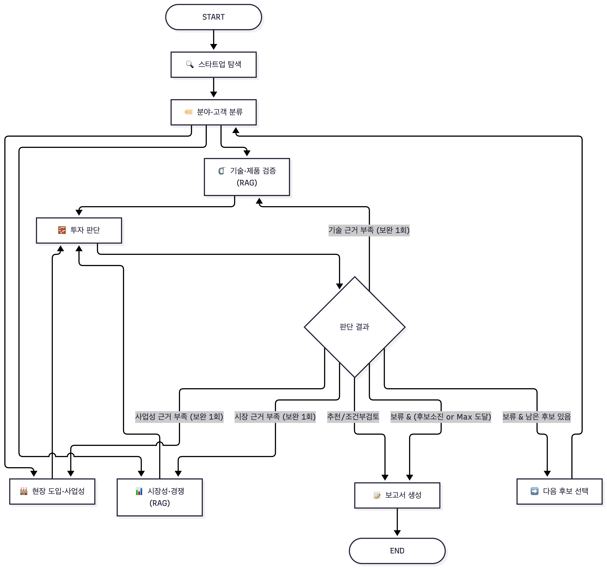

# Physical AI·Robotics 투자 평가 — Supervisor 전환

기존 후보 탐색 → 후보별 분석 → 코드 가중합 투자 판단 → PDF 보고서 흐름을 유지하면서
Supervisor 기반 동적 조사와 보고서 품질 평가로 전환하는 프로젝트입니다.

현재 브랜치에는 공통 State·Reducer·NODE_WRITES, Supervisor, 선택형 Supervisor 그래프와
보고서 v2 구현이 포함되어 있습니다. evaluator와 나머지 관점 어댑터의 운영 연결 및
실제 API·LangSmith 캡처는 별도 확인이 필요합니다. `app.py`는 Supervisor 그래프를 실행합니다.

## Overview

- 목표: 후보 기업을 기술·시장·이해관계자·도메인 4관점에서 근거 기반으로 평가합니다.
- 선정 패턴: Supervisor. 부족한 관점만 보완하고 평가 피드백에 따라 재작성·재조사를 선택하는 목적입니다.
- 동적 충분성 기준: 결과 status가 done이고 missing_items가 없으며 독립 출처 그룹이 2개 이상.
  현재 Supervisor는 같은 URL 호스트 또는 같은 문서를 하나의 출처 그룹으로 셉니다.
- 투자 판단: Python 가중합·Safety Gate를 유지합니다. 보고서에는 점수와 근거·한계를 균형 있게 서술합니다.
- 기준: [업무지침 v2](<docs/261013_agent_업무지침_v2 (1).md>), [공통 State 계약](docs/STATE_CONTRACT.md).

## Features

- 기존 PDF·시장 문헌 RAG와 웹 검색 기반 후보 탐색 및 분석.
- 관점별 최신 결과 병합, 출처 ID별 중복 제거, 노드별 쓰기 허용 필드 검사.
- 보고서 한 노드에서 PDF·구조화 초안 반환, `eval_result.feedback` 반영 재작성.
- 4관점·RISKS·점수 근거·근거 부족 항목, 실제 인용만 REFERENCE로 연결.
- 최종 평가된 본문을 재생성하지 않고 통과/미통과 상태를 PDF에 반영하는 출력 함수.
- 명시된 Git 링크·PDF·트레이스 파일만 ZIP으로 패키징.

확증 편향 통제는 기업 자체 주장과 외부 검증, 장점과 제약을 구분하도록 작성 지시합니다.
Hybrid evaluator가 Groundedness·중립성·편향 통제·관점 커버리지를 판정하고 재작성·재조사를 요청합니다.

## Tech Stack

| 항목      | 구성                                                    |
| --------- | ------------------------------------------------------- |
| Graph     | LangGraph                                               |
| Generator | ChatOpenAI, 모델은 `OPENAI_MODEL`, 보고서 temperature=0 |
| Judge     | Hybrid evaluator, OPENAI_JUDGE_MODEL 또는 OPENAI_MODEL  |
| Retrieval | Chroma, 기술 MMR / 시장 BM25 + Dense similarity         |
| Embedding | `nlpai-lab/KURE-v1`                                     |
| Web       | Tavily                                                  |
| PDF       | ReportLab 생성, PyMuPDF 페이지·본문 검증                |
| Models    | Pydantic + 공통 TypedDict                               |

기존 검색 평가 기록을 재사용합니다. KURE-v1 Hybrid의 **content Recall@5=0.867,
MRR@5=0.671**, 도메인 확인 질문 5개는 모두 Top-3에 정답이 있었습니다.
Hit Rate와 Recall은 평가 정의가 다르므로 해당 값을 별도 Hit Rate 측정값으로 표기하지 않습니다.
이번 보고서 작업에서 검색 평가를 다시 실행하지 않았습니다. [평가 방법·원 결과](docs/MARKET_RETRIEVAL_EVAL.md)

## Agents

| 구성                   | 현재 구현·연결 상태                                                                      |
| ---------------------- | ---------------------------------------------------------------------------------------- |
| discovery              | 기존 후보 탐색·검증                                                                      |
| profile                | 기존 고객·구매자·도메인 분류                                                             |
| technical              | 기술 분석·공통 관점 어댑터·보완 조사 구현                                                |
| market                 | 기존 시장·경쟁 분석. 공통 관점 어댑터·보완 조사 연결 필요                                |
| stakeholder / domain   | 기존 business를 view별로 연결하는 작업 필요                                              |
| investment_decision    | 기존 6항목 가중합·정보 부족/위험 Safety Gate                                             |
| report_generation      | v2 `report` + `report_draft` 반환, 4관점·risks·decision_basis, feedback 재작성           |
| 보고서 최종 출력       | 기존 report_generation 재호출 시 통과/세 번째 미달 판정을 감지하여 본문 재생성 없이 반영 |
| Supervisor / evaluator | Supervisor·State 기반 라우팅 구현. evaluator 운영 노드는 연결 필요                       |

보고서 스키마와 evaluator 연동 방법: [SUPERVISOR_REPORT.md](docs/SUPERVISOR_REPORT.md).

## State Schema

공통 파일은 통합 담당자가 관리합니다. 아래는 현재 코드와 제공된 계약의 대응입니다.

| 항목             | 설계·구현                                                                                                        | 코드/연결 위치                                                     |
| ---------------- | ---------------------------------------------------------------------------------------------------------------- | ------------------------------------------------------------------ |
| 제어 vs 페이로드 | 결과와 제어 메타 블록 분리, `NODE_WRITES`로 쓰기 제한. report는 report·report_draft만 반환                       | state.py, contracts.py                                             |
| 관측성 위치      | State에 로그 본문을 누적하지 않음. 외부 JSONL·LangSmith 로거 연결 필요; 현재 guard는 print 사용                  | contracts.py; logger/app은 통합 예정                               |
| 지속성 비용      | analyses는 관점별 최신 결과, references는 source_id 기준 병합. 후보 초기화에 Overwrite 제공                      | merge_dict, dedupe_by_source_id, candidate_reset_update            |
| 상관             | 초기 상태 trace_id 생성, PDF 파일명·머리말에 사용. 로그·LangSmith metadata 연결 필요                             | create_initial_state, report.py; app 통합 예정                     |
| 재개/복구        | node_status·node_errors 보존, Supervisor가 실패 관점을 재작업 상한 내 재배정                                     | state.py, contracts.py, orchestration/supervisor.py                |
| 동시 처리        | analyses·node_status·node_errors 사전 병합, references dedupe reducer                                            | state.py                                                           |
| 종료 보장        | 관점 재작업 2회, Supervisor max_steps 기본20, evaluator 미달3회 후 한계 보고서1회 출력·종료, 후보 max_iterations | orchestration/supervisor.py, control.route_after_report, report.py |

`report_attempts`는 **평가 미달 횟수**입니다. 최초 미달(1), 두 번째 미달(2)은 보완하고,
세 번째 미달(3)에는 report_generation이 한 번 더 호출되어 평가받은 초안으로
미통과 사유를 표시한 한계 보고서를 출력하고 control.route_after_report에서 종료합니다.
보고서 본문을 다시 생성하거나 평가를 네 번째 수행하지 않습니다.
정상 통과도 기존 report_generation을 한 번 재호출하여 FINAL / PASS 표시 후 종료합니다.

종료 검증: 실제 build_graph와 Supervisor에 항상 미달하는 대체 evaluator를 연결하고
`config={"recursion_limit": 100}`으로 실행했습니다. evaluator 3회·본문 작성 3회·
보고서 출력 4회에서 report_attempts=3으로 종료했습니다. 이 테스트 설정은
운영 app.py의 설정을 바꾸지 않으며 실제 LangSmith 트레이스 증빙이 아닙니다.

## Architecture

build_graph는 AgentNodes.supervisor를 주면 Supervisor 흐름, 생략하면 기존 병렬 흐름입니다.
아래 그림은 기존 실행 구조입니다.



Supervisor 그래프의 보고서·평가 분기:

```text
report_generation → evaluator
                      ├─ rewrite → report_generation
                      ├─ research → supervisor → 필요한 관점 → report_generation
                      └─ 통과/미달3회 → report_generation(최종 상태 반영) → END
```

별도 final_report 노드를 추가하지 않습니다. report_generation.run이 최종 판정을 감지하고
평가받은 본문을 유지하여 출력합니다. finalize_report는 직접 호출용 함수로만 유지합니다.

## Directory Structure

```text
ai_analysis/
├── app.py                       # Supervisor 실행 진입점
├── requirements.txt
├── data/                        # 기술·시장 원문, manifest, 검색 평가 질문
├── docs/                        # 설계·공통 계약·보고서 설명·기존 그래프 이미지
├── examples/
│   ├── run_business_agent.py
│   └── run_report_preview.py    # 외부 API 없는 가상 PDF 미리보기
├── scripts/
│   ├── ingest_tech_docs.py
│   └── package_submission.py   # 명시 파일만 ZIP 생성
├── src/ai_investment/
│   ├── agents/                 # 기존 탐색·profile·분석·decision, v2 report
│   ├── orchestration/          # Supervisor·관점 정의·Hybrid evaluator
│   ├── utils/logger.py         # 실행별 JSONL 로그
│   ├── tools/                  # 웹·RAG 검색
│   ├── state.py                # 공통 State·Reducer·초기화
│   ├── contracts.py            # 공통 NODE_WRITES·guard
│   ├── graph.py                # 기존/선택형 Supervisor 그래프
│   ├── orchestration/          # Supervisor·관점 계약·결정 로그
│   ├── utils/                  # 외부 결정 로그
│   ├── control.py
│   ├── scoring.py
│   ├── ingest.py
│   └── retrieval_eval.py
├── tests/                      # 단위 테스트, 대체 Judge를 사용한 연결 검증
├── outputs/                    # 기존 분석 결과; 실제 트레이스 저장 위치
└── output/
    ├── pdf/                    # 생성 보고서 (Git 제외)
    └── submission/             # 제출 ZIP (Git 제외)
```

## Usage

실행 환경:

```bash
python3 -m venv .venv
source .venv/bin/activate
pip install -r requirements.txt
```

`.env`에 OPENAI_API_KEY, OPENAI_MODEL, TAVILY_API_KEY를 설정합니다.

Tavily 검색은 같은 프로세스의 모든 Agent가 공통 호출 간격을 사용합니다.
기본 `TAVILY_MIN_INTERVAL_SECONDS=1`이며, 429일 때 `TAVILY_RETRY_BACKOFF_SECONDS=15`를
기준으로 15초·30초 대기 후 재시도합니다. 총 3회 실패하면 중단합니다. 인증·입력 오류는
이 경로에서 재시도하지 않고, 검색 실패를 빈 검색 결과로 처리하지 않습니다.
같은 키를 사용하는 다른 프로세스의 호출은 이 제한에 포함되지 않습니다. 반복 429가 발생하면
Tavily Dashboard에서 키 유형과 공유 사용을 확인합니다.
[공식 429 안내](https://help.tavily.com/articles/8645538886-understanding-http-errors).

REPORT_FONT_PATH는 자동 탐색 가능한 한글 폰트가 없을 때 한글 TTF 절대 경로로 지정합니다.
LangSmith 캡처를 사용할 때는 LANGSMITH_TRACING=true, LANGSMITH_PROJECT,
LANGSMITH_API_KEY를 설정합니다. 기존 LANGCHAIN_TRACING_V2·LANGCHAIN_PROJECT 설정도 사용할 수 있습니다.
진입점에서 trace_id metadata와 실행 이름을 전달합니다. `.env`는 app.py와 같은 디렉토리에서 읽습니다.
OPENAI_JUDGE_MODEL은 생략하면 OPENAI_MODEL을 사용합니다.

```bash
# Supervisor 실행: 외부 API 사용, 첫 확인은 후보 1개
python app.py --limit 1 --max-iterations 1

# 기업 직접 지정: 제품·투자 단계는 임의로 채우지 않음
python app.py --company "플라잎" --max-iterations 1

# Supervisor 호출 상한 지정
python app.py --limit 2 --max-iterations 2 --max-steps 20

# 벡터 DB 구축: 임베딩 다운로드 필요
PYTHONPATH=src python -m ai_investment.ingest market
PYTHONPATH=src python scripts/ingest_tech_docs.py

# 외부 API 없는 가상 PDF 미리보기
python examples/run_report_preview.py

# 검증: 실제 API 테스트는 기본 생략
PYTHONPATH=src python -m unittest discover -s tests -v
```

최소 보고서 검증 의존성은 pydantic, reportlab, pymupdf, python-dotenv,
langgraph, langchain-openai이며 전체 테스트에는 langchain-tavily와 langchain-text-splitters도 사용합니다.

최종 PDF와 실제 트레이스를 확보한 뒤 값들을 교체해 실행합니다.

```bash
python scripts/package_submission.py \
  --repo-url 'https://github.com/songjung-good/ai_analysis/tree/AI_Orchestration' \
  --report output/pdf/FINAL.pdf --traces outputs/tracing-1.png outputs/tracing-2.png \
  --campus CAMPUS --class-name CLASS --names NAME1+NAME2 --run-id ACTUAL_TRACE_ID
```

ZIP에는 Git 링크·PDF·번호순 PNG·실행 ID/해시 manifest를 포함합니다. 가상 샘플과 초안 PDF는
제출 도구가 거부합니다. 미통과 종료는 최종 한계 보고서로 구분합니다.
실제 PNG의 재작업·평가 루프, PDF와 캡처가 같은 실행인지 최종 확인해야 합니다.

## Verification

보고서 검증은 v2 입력·정확한 쓰기 계약·feedback 전달·출처 범위·점수 보존·후보 부재·
재작성 연결·최종 통과/미달 상태·10쪽 상한·원자적 출력을 확인합니다.
Mock Judge를 사용한 테스트는 운영 Judge의 품질이나 실제 LangSmith 실행을 증명하지 않습니다.
2026-10-13 통합·429 회귀 검증: 전체 252개 중 248개 통과, 실제 API 테스트 4개 생략. [v2 검증 체크리스트](docs/REPORT_V2_CHECKLIST.md).

## Contributors

기존 README의 개인별 구현 기록을 유지하고 이번 보고서 변경을 반영했습니다.

| 담당   | 기존 구현 및 이번 브랜치에서 확인한 변경                                                                                  |
| ------ | ------------------------------------------------------------------------------------------------------------------------- |
| 배영환 | 기존 business/decision. 이번 원격 변경의 공통 State·Reducer·NODE_WRITES·후보 초기화 계약                                  |
| 박주윤 | 기존 technical 분석·기술 문서 RAG                                                                                         |
| 이경민 | 기존 market 분석·검색 평가                                                                                                |
| 배은빈 | 기존 profile 분류·고객/구매자 모델                                                                                        |
| 윤도균 | 기존 discovery. 보고서 v2 4관점·decision_basis·초안/PDF 동시 반환·feedback 재작성·최종 평가 상태 출력, README 및 ZIP 도구 |

남은 확인: 실제 API 동적 실행·Judge 내용 판정·LangSmith 캡처·최종 제출 자료 확정.
